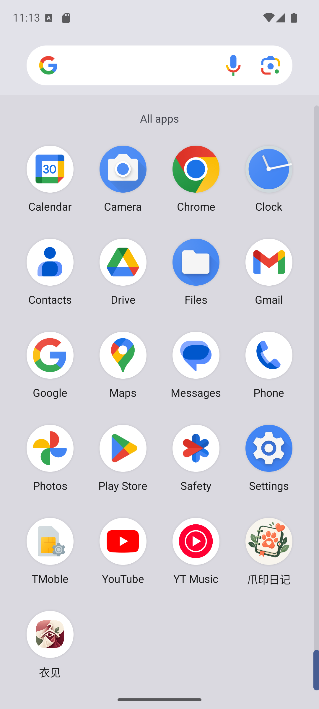
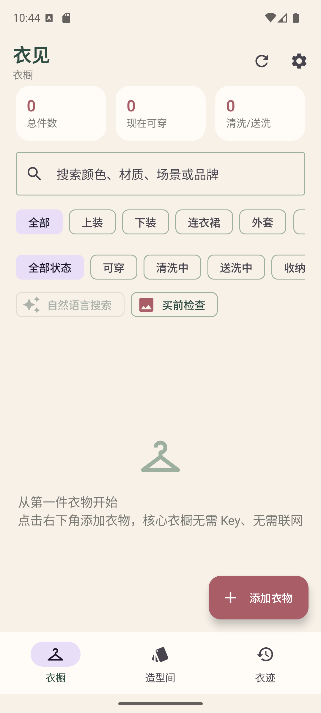
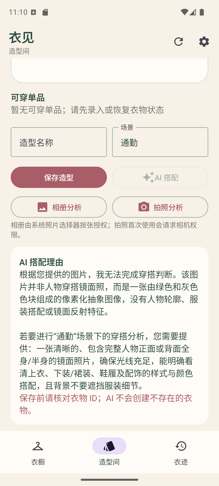

# 衣见 / AI 数字衣橱

[](https://github.com/wutao2022/ai-digital-wardrobe/actions/workflows/android-ci.yml)
[](LICENSE)
[](https://kotlinlang.org/)
[](https://developer.android.com/)

衣见是一款原生 Android Kotlin + Jetpack Compose 数字衣橱应用。衣物、照片、筛选、搭配、穿着记录、统计和备份恢复默认在设备本地运行；AI 功能由用户自行配置 DeepSeek 与阿里云百炼凭据，并在每次发送前确认图片、服务商、模型、用途与费用提示。

> English summary: YiJian is a local-first native Android AI wardrobe app built with Kotlin and Jetpack Compose. Core wardrobe data stays on device. Optional AI features are user-configured and confirmation-gated.

## 应用截图

| 桌面图标 | 衣橱首页 | DeepSeek 图片分析 |
| --- | --- | --- |
|  |  |  |

## 核心功能

- 三入口导航：衣橱、造型间、衣迹；设置不占用底部导航。
- 本地 SQLite 数据库与应用私有媒体目录；单件衣物最多保存 5 张照片。
- Android 系统照片选择器按张授权、原生相机拍摄和图片穿搭分析。
- 衣物分类、季节、场景、颜色、标签、状态筛选；状态自动联动可穿池。
- 自由搭配画布，支持衣物移动、缩放、旋转、层级和保存。
- 穿着日历、次数统计、单次成本与分类统计。
- 完整 ZIP 备份、校验与恢复；API Key 和临时上传凭证不会进入备份。
- DeepSeek：衣物视觉识别、镜面照与买前图片分析、搭配分析、自然语言搜索和穿搭复盘。
- 阿里云百炼：`aitryon`、`aitryon-plus`、`aitryon-refiner`、`aitryon-parsing-v1`、`shoemodel-v1`。
- WorkManager 后台生图任务、固定比例占位、真实阶段提示、shimmer、失败停止和减少动态效果适配。

## 隐私与安全

- API Key 使用 Android Keystore 保护的 AES/GCM 密文保存。
- Key 不写入源码、SQLite、日志、崩溃报告、备份、APK 资源或本仓库。
- 设置页启用安全窗口，常规系统截图不能捕获凭据页面。
- 系统照片选择器只授权用户实际选中的图片；相机权限只在主动拍摄时申请。
- 每次云端 AI 调用前都展示实际图片、服务商、模型、用途及可能费用，并等待用户确认。
- 本项目不会宣称云端 AI 完全离线；不代收任何模型费用。

## 环境要求

- JDK 17 或更高版本
- Android Studio 或 Android SDK 36
- Android 8.0（API 26）或更高版本设备/模拟器
- Windows、macOS 或 Linux

## 快速开始

```bash
git clone https://github.com/wutao2022/ai-digital-wardrobe.git
cd ai-digital-wardrobe
./gradlew assembleDebug
```

Windows PowerShell：

```powershell
git clone https://github.com/wutao2022/ai-digital-wardrobe.git
Set-Location ai-digital-wardrobe
.\gradlew.bat :app:assembleDebug
```

Debug APK 生成于 `app/build/outputs/apk/debug/`。首次启动不会预置任何 API Key 或 Workspace ID。

## AI 配置

1. 打开应用右上角“设置”并进入“AI 模型中心”。
2. DeepSeek 使用用户自己的 API Key。
3. 阿里云百炼统一使用同一业务空间的华北 2（北京）API Key 与 Workspace ID。
4. 保存配置后先运行“测试连接”，再按需启用服务总开关和独立能力开关。
5. 每次真实调用仍需在发送确认页人工确认。

不要将真实凭据写入源码、Gradle 属性文件、Issue、日志或截图。完整说明见 [安装与 API 配置说明](安装与API配置说明.md) 和 [百炼配置指南](百炼API-Key与Workspace-ID配置指南.md)。

## 构建与测试

```bash
./gradlew testDebugUnitTest lintDebug assembleDebug
```

连接 Android 设备或模拟器后：

```bash
./gradlew connectedDebugAndroidTest
```

Release 签名必须使用自己的 JKS，并通过 Gradle 属性注入以下值：

- `YIJIAN_STORE_FILE`
- `YIJIAN_STORE_PASSWORD`
- `YIJIAN_KEY_ALIAS`
- `YIJIAN_KEY_PASSWORD`

不要提交密钥库或签名密码。仓库不提供开发者的正式签名材料。

## 项目结构

```text
app/                         Android 应用与测试代码
gradle/                      Gradle Wrapper 配置
.github/                     CI、Issue 与 PR 模板
AI数字衣橱产品设计.md          产品与交互设计说明
安装与API配置说明.md           安装、权限和模型配置说明
百炼API-Key与Workspace-ID配置指南.md
全量测试验收报告.md            当前版本的测试边界与结果
```

## 参与贡献

欢迎提交问题、功能建议与 Pull Request。开始前请阅读 [CONTRIBUTING.md](CONTRIBUTING.md)、[CODE_OF_CONDUCT.md](CODE_OF_CONDUCT.md) 和 [SECURITY.md](SECURITY.md)。涉及 AI 服务商行为时，请明确区分固定错误注入与真实供应商验证。

## 免责声明

本项目与 DeepSeek、阿里云及其关联公司不存在官方隶属或背书关系。第三方模型名称与商标归各自权利人所有。模型可用性、价格、免费额度和区域端点可能变化，请以服务商当前官方文档为准。

## 许可证

项目源码以 [Apache License 2.0](LICENSE) 开源。提交贡献即表示你同意按同一许可证发布贡献内容。

